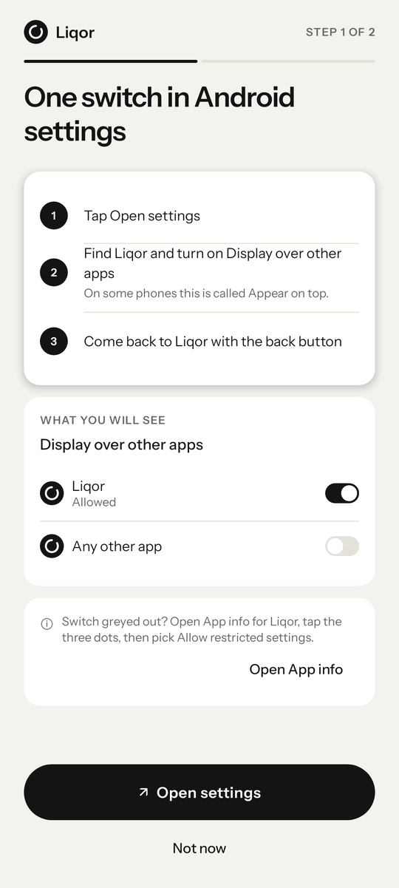
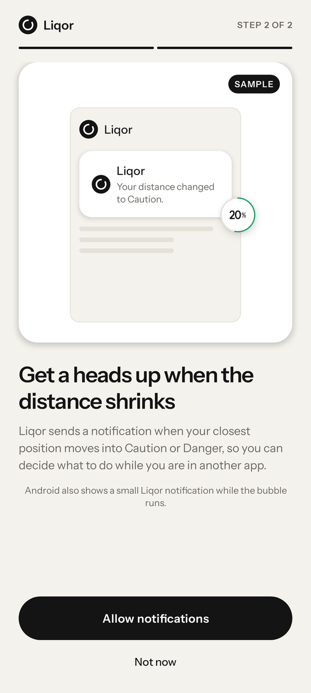

# Liqor

Liqor shows how far you are from liquidation in a small bubble that floats over any app on your Solana Seeker.

Open a leveraged Jupiter Perps trade, switch to X, Telegram or a game, and the market keeps moving. Borrow fees also pull your liquidation price closer while the price sits still. Positions get liquidated while their owners are busy in another app. Liqor keeps one number on screen: the price move that would liquidate your closest position.

<table>
  <tr>
    <td></td>
    <td></td>
    <td></td>
  </tr>
  <tr>
    <td></td>
    <td></td>
    <td></td>
  </tr>
</table>


The first row is from a live run against mainnet positions. The second row and the bubble states are rendered from the app's snapshot tests.

## What it does

- **Bubble over any app.** The % move to liquidation for your closest position, tagged with its coin and direction (`BTC ↑` for a short, `SOL ↓` for a long). Drag it anywhere and it snaps to the edge. Drop it at the bottom to hide it.
- **Panel on tap.** "BTC can rise 1.1%", a train line from entry through now to liquidation for each position, the data age and an Open Jupiter button.
- **Colour by distance travelled.** Safe below 50% of the way from entry to liquidation, Caution from 50% to 80%, Danger above 80%, where the bubble fills red.
- **Honest data.** Grey with a clock after 30 seconds without fresh data. "–" after 120 seconds or any failed check, so an old number never shows in green.
- **Alerts.** One vibration and one notification when a position moves to a worse state and holds it for 20 seconds. An ongoing notification always carries the sentence.
- **Read-only.** Mobile Wallet Adapter `connect()` reads your public address. The app never signs.
- **Sample mode.** With no open position you get a SAMPLE card and bubble that never alert.

## Position data

The Android app reads Jupiter Perps accounts directly from Solana mainnet RPC and Beta markets, trading accounts, and positions from GUM's public JTX API. It reads both sources together and only displays a result when both checks succeed. Beta coverage includes JUP, HYPE, ZEC, SPCX, SNDK, SKHYNIX and other GUM markets.

## Run it

Install the APK from [Releases](https://github.com/fozagtx/Liqor/releases).

Build the Android app:

```sh
./gradlew :app:assembleDebug
```

Pushing a `v*` tag builds the APK on GitHub Actions and attaches it to a release.
