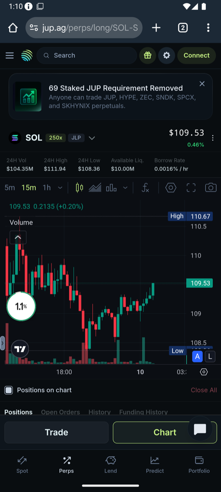
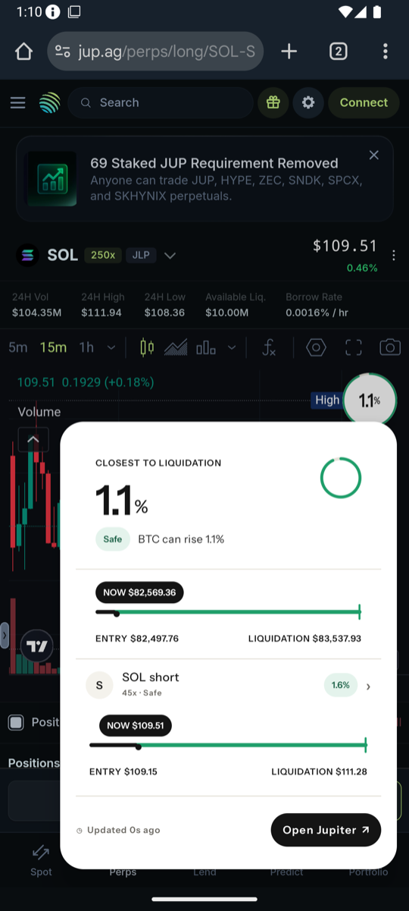
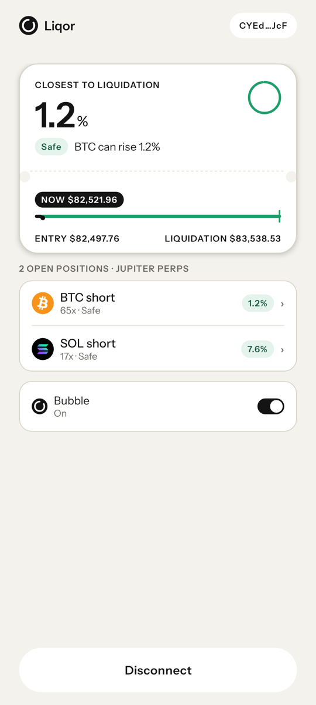
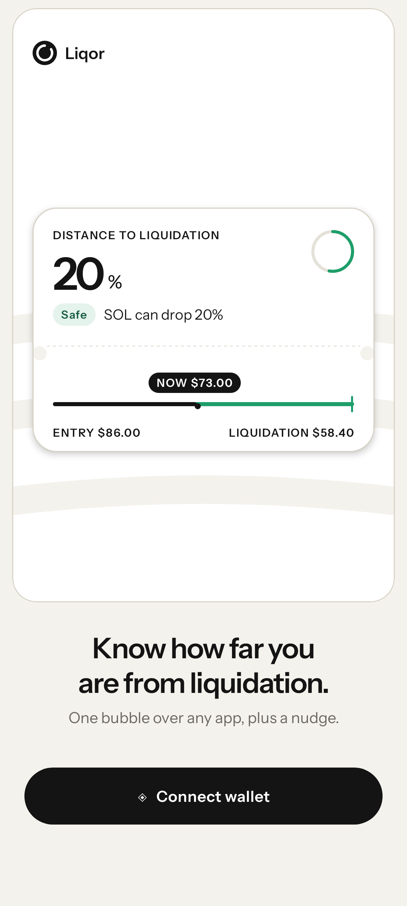
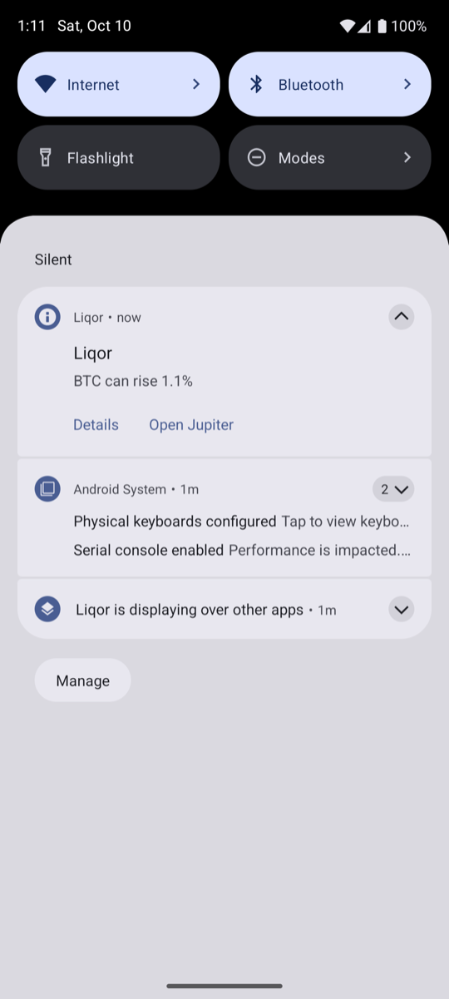

# Liqor

Liqor shows how far you are from liquidation in a small bubble that floats over any app on your Solana Seeker.

Open a leveraged Jupiter Perps trade, switch to X, Telegram or a game, and the market keeps moving. Borrow fees also pull your liquidation price closer while the price sits still. Positions get liquidated while their owners are busy in another app. Liqor keeps one number on screen: the price move that would liquidate your closest position.

<table>
  <tr>
    <td></td>
    <td></td>
    <td></td>
  </tr>
  <tr>
    <td></td>
    <td></td>
  </tr>
</table>


The phone screenshots are from a live run against mainnet positions. The bubble states are rendered from captured mainnet data.

## What it does

- **Bubble over any app.** The % move to liquidation for your closest position, tagged with its coin and direction (`BTC ↑` for a short, `SOL ↓` for a long). Drag it anywhere and it snaps to the edge. Drop it at the bottom to hide it.
- **Panel on tap.** "BTC can rise 1.1%", a train line from entry through now to liquidation for each position, the data age and an Open Jupiter button.
- **Colour by distance travelled.** Safe below 50% of the way from entry to liquidation, Caution from 50% to 80%, Danger above 80%, where the bubble fills red.
- **Honest data.** Grey with a clock after 30 seconds without fresh data. "–" after 120 seconds or any failed check, so an old number never shows in green.
- **Alerts.** One vibration and one notification when a position moves to a worse state and holds it for 20 seconds. An ongoing notification always carries the sentence.
- **Read-only.** Mobile Wallet Adapter `connect()` reads your public address. The app never signs.
- **Sample mode.** With no open position you get a SAMPLE card and bubble that never alert.
- **Jupiter Perps Beta.** Liqor also watches every open market reported by GUM, including JUP, HYPE, ZEC, SPCX, SNDK and SKHYNIX. Beta accounts and positions are read from GUM's public JTX API.

## Accuracy

Liquidation prices from the Worker against Jupiter's own, on live mainnet positions:

| Position | Side | Jupiter | Liqor |
| --- | --- | --- | --- |
| SOL `A6Ke3X` | short | 117.26 | 117.2596 |
| SOL `Gr9GWC` | long | 79.30 | 79.3041 |
| SOL `Fgj612` | long | 104.21 | 104.2054 |
| BTC `BTeM8V` | short | 83,538.67 | 83,538.6664 |
| SOL `9hGGxa` | short | 111.28 | 111.2778 |

The largest JLP gap is 0.006%. To compare any wallet against Jupiter Perps and GUM, run `npm run check -- <worker url> <wallet>` in `worker/`.

## How it works

- `app/` Kotlin and Jetpack Compose, Android 13 and up, targets Android 16. A `specialUse` foreground service owns the bubble and panel overlay windows and polls the Worker every 5 to 60 seconds. The phone re-checks each JLP answer with a rough estimate within 5%. Beta answers use the Worker-verified liquidation price. The app recomputes distance and shows "–" on any doubt.
- `worker/` Cloudflare Worker in TypeScript. It reads Jupiter Perps pool, custody, price-feed and wallet account data over Solana RPC, and reads Beta markets and trading accounts from GUM's public JTX API. Both sources run together, and a failed source fails the check. It caches each wallet for 5 seconds and stores nothing.

## Run it

Install the APK from [Releases](https://github.com/fozagtx/Liqor/releases).

Build it yourself:

```sh
./gradlew :app:assembleDebug
cd worker && npm install && npx wrangler dev
```

Deploy the Worker, then put its URL in `WORKER_URL` in `app/src/main/java/com/liqor/Config.kt`:

```sh
cd worker
npx wrangler secret put HELIUS_API_KEY
npx wrangler deploy
```

Pushing a `v*` tag builds the APK on GitHub Actions and attaches it to a release.
